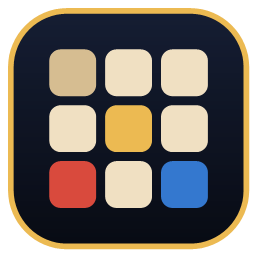

# كلمة سر — Codenames Masry

لعبة كود نيمز مصرية للشلة: ميمز، نجوم، أكل، أماكن، وكلمات من عندك.
تشتغل على ويندوز كملف `.exe` واحد — من غير تنصيب، ومن غير سيرفر مدفوع.



## التشغيل

- **الملف الجاهز:** `dist/Codenames-Masry-1.0.0.exe` — دوس عليه وبس.
- **من السورس:**
  ```powershell
  npm install
  npm start
  ```

## طرق اللعب

| الوضع | إزاي بيشتغل |
| --- | --- |
| **على نفس الجهاز** | جهاز واحد، فريقين، تمرير الموبايل/اللابتوب بينكم. |
| **أونلاين مع أصحابك** | واحد يعمل غرفة ويبعت الكود (٥ حروف)، والباقي يدخلوا بالكود. |
| **عندي كود غرفة** | ادخل الكود اللي صاحبك بعتهولك. |

### أونلاين بدون سيرفر

الاتصال **P2P مباشر** بين الأجهزة (WebRTC عن طريق PeerJS). سيرفر PeerJS المجاني بيتستخدم
بس عشان الأجهزة تلاقي بعضها، وبعد كده اللعب كله ماشي بينكم. يعني مفيش سيرفر بتدفع فيه.

- الهوست هو اللي بيمسك حالة اللعبة، فلازم يفضل البرنامج مفتوح عنده.
- أول مرة ويندوز ممكن يسأل عن الفايروول — اختار **سماح**.
- اللي بيعمل الغرفة لازم يكون عنده نت.

## الأدوار والقواعد

- كل فريق ليه **ماستر** (بيشوف ألوان الكروت) و**خمّانين** (مش بيشوفوا غير الكلمات).
- الماستر بيقول كلمة واحدة + رقم، والخمّانين بيختاروا الكروت.
- عدد التخمينات = الرقم + ١.
- الكارت الأسود = خسارة فورية.
- الفريق اللي يخلّص كروته الأول يكسب.

## كلماتك

من الشاشة الرئيسية → **كلماتي**:

- كل سطر كلمة، وتقدر تضيف الترجمة بعد `=`:
  ```
  الشلة
  قهوة الحاجة
  عم مجدي بتاع البقالة = Uncle Magdy
  ```
- الباكدج بيتحفظ تلقائيًا على جهازك (`%APPDATA%`).
- **صدّر JSON** / **استورد JSON** لنقل الكلمات بين الأجهزة أو مشاركتها مع الشلة.
- عشان تلعب بالباكدج لوحده محتاج ٢٥ كلمة على الأقل.

الباكدجات الجاهزة: نجوم مصر، ميمز ومواقف، أكل مصري، أماكن، حياة يومية، تراث وأيام، English.

## اختصارات وملاحظات

- الأصوات متولّدة في البرنامج نفسه (WebAudio) — مفيش ملفات صوت.
- البيانات كلها محلية؛ مفيش تتبع ولا حسابات.
- الواجهة عربية RTL بالكامل، وخط Cairo متضمن جوّه التطبيق (يشتغل أوفلاين).

## التطوير

```powershell
npm test      # اختبارات محرك اللعبة (١٢ اختبار)
npm start     # تشغيل من السورس
npm run dist  # بناء ملف exe محمول في dist/
```

بنية المشروع:

```
main.js            نافذة Electron + التخزين المحلي + تصدير/استيراد الملفات
preload.js         جسر آمن بين الواجهة وElectron
src/index.html     كل الشاشات
src/styles.css     الثيم (ليل/ذهبي/رملي)
src/app.js         منطق الواجهة واللعب المحلي والأونلاين
src/engine.js      محرك اللعبة النقي (مستخدم في الاختبارات)
src/net.js         غلاف PeerJS (هوست/ضيف)
src/data/words.js  باكدجات الكلمات
test/              اختبارات المحرك
scripts/           أدوات تطوير (سكرين شوتس، أيقونة، سيرفر معاينة)
```
